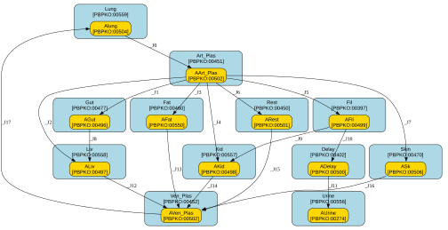

# Antimony/SBML re-implementation PFAS PBK model Westerhout (2024)

[](https://github.com/fair-pbk/pbk-pfas-westerhout-2024/actions/workflows/validate.yml)

This repository contains the source code of a FAIR reimplementation of the PFOS/PFOA PBK model of [Westerhout et al. (2024)](https://doi.org/10.1093/toxsci/kfae006), which in turn was based on the model of [Loccisano et al. (2011)](https://www.sciencedirect.com/science/article/abs/pii/S0273230010002242]). The model is implemented in Antimony and available as an annotated SBML file in accordance with the [FAIR PBK standard](https://doi.org/10.1016/j.comtox.2026.100426).

# Model implementation

The file [pbk_pfas_westerhout_2024.ant](model/pbk_pfas_westerhout_2024.ant) is the Antimony implementation. The file [pbk_pfas_westerhout_2024.csv](model/pbk_pfas_westerhout_2024.csv) contains the unit specifications and the model element annotations according the FAIR PBK standard, using the harmonized terminology of the [PBPKO ontology](https://github.com/InSilicoVida-Research-Lab/pbpko). A diagram of the model compartments and species is shown below.



# Model revision

Compared to the original model code, the following changes were made in this reimplementation:

1. **Generic structure for PFOS and PFOA:** Instead of presenting two separate implementations for PFOS and PFOA, this model implementation represents a generic model structure, applicable also for PFAS.

2. **Correction in calculation of free fractions in plasma:** The calculation of `CvenFree`, `Cven`, `CartFree` and `Cart` was changed to correctly present the free fraction in arterial and venous plasma.

3. **Correction of lung equation:** Corrected equation for lung to use `FreeLun` instead of `Free`.

4. **No built-in dosing:** The reimplementation has no built-in exposure/dosing parameters for oral dose, drinking-water concentration, inhalation, or dermal exposure.

5. **Body-weight parameterisation:** The R implementation calculates body weight as `BWbirth + f(age)`. The Antimony model adds `BWRef` and `AgeRef` and scales that same age-growth function (using the `deltaBW` parameter) so body weight equals `BWRef` at `AgeRef`.

6. **Physiological parameterisation:** The reimplementation exposes `FBW`, `QfilC`, `VartC` and `VvenC` as parameters, which are hard-coded in the original implementation. They can therefore be changed through the parameterisation without editing the model equations.

## Validation

The SBML implementation is validated against two R implementations of the original model: [run_westerhout_2024.R](validation/R/run_westerhout_2024.R) and [run_westerhout_2024_no_dosing.R](validation/R/run_westerhout_2024_no_dosing.R). The validation scenarios include, for both PFOS and PFOA, a simulation of 5 days using an initial amount of 100 ug in the liver and a lifetime scenario with repeated dosing of 0.001 ug/kg bw/day.

## Running the scipts

### Prerequisites

To run scripts you will need Python installed on your system, along with several additional packages. You can install these packages using the following command:

```
pip install -r requirements.txt
```

### Compile model

To convert the Antimony model implementation to SBML and annotates it, type:

```
python ./scripts/create_sbml.py
```

### Create model docs

To create the [model documentation page](docs/pbk_pfas_westerhout_2024.report.md), type:

```
python ./scripts/create_report.py
```

### Run validation scenarios

To run the run simulation scenarios, type:

```
python ./scripts/run_validation.py
```

By default, this script reuses existing outputs from previous runs. To override and recalculate outputs that already exist, use the `-f` option.

To run the run simulation scenarios for a specific scenario config (e.g. thos defined in [validation/scenarios/oral_single.yaml](validation/scenarios/oral_single.yaml)), type:

```
python ./scripts/run_validation.py -c validation/scenarios/PFOA.yaml
```
